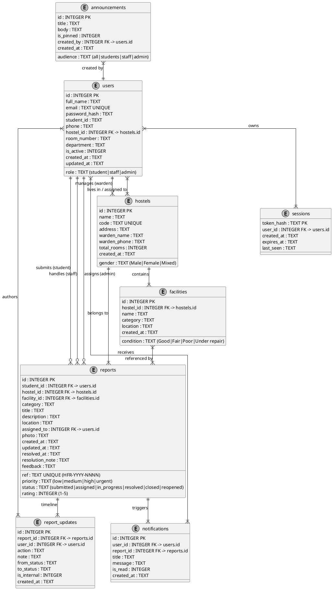

# Entity–Relationship Diagram (text form)

HostelHub's data model is stored in a single SQLite file. Below is a
machine-readable PlantUML rendering plus a plain-text summary you can paste
into any ER diagram tool (draw.io, dbdiagram.io, Lucidchart, etc.).

## PlantUML (paste at https://www.plantuml.com/plantuml)

## Plain-text summary

| Table | Purpose | Key relationships |
|-------|---------|-------------------|
| `users` | Students, maintenance staff, administrators | `hostel_id` → `hostels` |
| `hostels` | Halls of residence (warden, capacity, gender) | — |
| `facilities` | Registered assets per hostel (tap, fan, Wi-Fi AP…) | `hostel_id` → `hostels` |
| `reports` | Fault reports with priority, status, SLA | `student_id` → `users`; `hostel_id` → `hostels`; `facility_id` → `facilities`; `assigned_to` → `users` |
| `report_updates` | Immutable audit timeline per report | `report_id` → `reports`; `user_id` → `users` |
| `notifications` | Per-user inbox items | `user_id` → `users`; `report_id` → `reports` |
| `announcements` | Pinned notices for audiences | `created_by` → `users` |
| `sessions` | Hashed auth tokens with expiry | `user_id` → `users` |

## Key business rules encoded in the schema

- A student sees only their own reports; staff see only assigned reports; admins see everything.
- `report_updates.is_internal` hides staff-only notes from students.
- `reports.resolved_at`, `rating` and `feedback` are populated only when status moves to `resolved`.
- `ref` is generated as `HFR-YYYY-NNNN` for human-readable ticket IDs.
- Foreign keys are enforced (`PRAGMA foreign_keys = ON`) with cascading deletes where appropriate.
